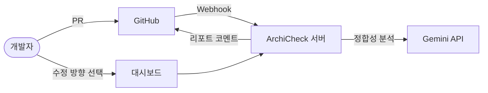

# ArchiCheck (아키체크)

> 코드가 바뀌면 설계 문서·다이어그램과 어긋난 부분을 찾아, 코드 수정 또는 문서 개정안을 제안하는 AI 에이전트

🚧 개발 중 (2026.11.16 ~ 11.20)

## 왜 필요한가

코드는 계속 바뀌지만 설계 문서와 다이어그램은 사람이 직접 고쳐야 해서 금방 낡습니다.
ArchiCheck는 PR이 올라올 때마다 **설계 문서를 기준으로 코드 변경을 검사**하고,
어긋난 부분을 **코드를 고칠지, 문서를 고칠지** 개발자가 선택하게 합니다.

## 주요 기능

- **설계 정합성 검사:** PR의 변경 코드와 설계 문서를 비교해 불일치 항목을 찾습니다.
- **PR 코멘트:** 검사 결과 요약과 대시보드 링크를 PR에 자동으로 남깁니다.
- **수정 방향 선택:** 불일치 항목마다 [코드 수정] 또는 [문서 개정]을 고를 수 있습니다.
- **수정안 생성:** 코드 수정안(diff) 또는 문서 개정안(수정 문구 + 갱신된 Mermaid 다이어그램)을 만듭니다.
- **대시보드:** 분석 이력, 리포트 상세, 수정안을 웹에서 확인합니다.

## 동작 방식



## 기술 스택

| 구분 | 기술 |
|---|---|
| 서버 | Python, FastAPI |
| 저장소 | SQLite |
| 대시보드 | HTML/JS, mermaid.js, diff2html |
| AI | Gemini API |
| 인프라 | 네이버 클라우드 플랫폼(NCP) |
| 연동 | GitHub Webhook, GitHub REST API |

## 문서

- [설계 문서](docs/DESIGN.md)

## 실행 방법

```bash
python -m venv .venv
.venv\Scripts\activate          # macOS/Linux: source .venv/bin/activate
pip install -r requirements.txt
cp .env.example .env            # 값 채우기 (아래 표)
cd server/diagram && npm ci && cd ../..   # Mermaid 문법 검증용 (Node.js 22.22 이상)
uvicorn server.main:app --reload
```

- `http://localhost:8000/health`에서 `{"status":"ok"}`가 나오면 정상입니다.
- 대시보드: `http://localhost:8000/dashboard/` (비밀번호는 `DASHBOARD_PASSWORD`)
- Node.js나 `npm ci`를 건너뛰어도 서버는 뜹니다. 이때는 Mermaid 문법 검증만 건너뜁니다.

| 환경 변수 | 설명 |
| --- | --- |
| `GEMINI_API_KEY` | Gemini API 키 ([Google AI Studio](https://aistudio.google.com)에서 발급) |
| `GEMINI_MODEL` | (선택) 모델 이름. 비우면 `gemini-3.5-flash-lite` |
| `GITHUB_TOKEN` | 대상 레포의 PR 읽기·코멘트 쓰기 권한이 있는 토큰 |
| `GITHUB_WEBHOOK_SECRET` | 대상 레포 Webhook에 넣은 secret과 같은 값 |
| `DASHBOARD_PASSWORD` | 대시보드 로그인 비밀번호 |
| `SESSION_SECRET` | 세션 쿠키 서명 키 (임의의 긴 문자열) |
| `PUBLIC_BASE_URL` | 서버 공개 주소. PR 코멘트의 대시보드 링크에 쓴다 |

자세한 내용은 [설계 문서 2.4](docs/DESIGN.md#24-배포-구성)를 참고하세요.

### 테스트

```bash
pytest                                      # 서버 단위 테스트
node --test dashboard/tests/app.test.js     # 대시보드 단위 테스트
```

## 협업 규칙

- `main`에 직접 push하지 않고, 브랜치에서 작업한 뒤 PR로 합친다.
- 브랜치 이름은 `종류/작업내용` 형식으로 짓는다. (예: `feat/dashboard`, `fix/webhook`, `docs/design`)
- 커밋 메시지는 `종류: 내용` 형식의 한 줄로 쓴다. (종류: `feat`, `fix`, `docs`, `refactor`)
- 작업 전 `git pull`로 최신 코드를 받는다.
- `.env` 파일은 올리지 않는다.
- 설계와 다르게 구현할 때는 [설계 문서](docs/DESIGN.md)를 먼저 고친다.
- 자기 담당 폴더만 수정한다. 담당 폴더는 [설계 문서 3.6·3.7](docs/DESIGN.md#37-역할-분담)을 따른다.
- PR은 팀장과 연관 팀원이 리뷰한 뒤 Merge한다. 리뷰가 몰리지 않도록 PR은 작게 나눠 하루 1회 이상 올린다.

## 팀원

| 번호 | 이름 | 역할 | 담당 업무 | GitHub |
|---|---|---|---|---|
| ① | 진다혜 | 팀장·AI 분석 | 설계 문서 작성·관리, 정합성 분석·수정안 생성(Gemini 호출, 프롬프트), Mermaid 재생성 루프, 리포트 JSON 형식, PR 리뷰·Merge, NCP 서버 배포, Webhook 등록·E2E 테스트, 발표 자료 | [Jindahye](https://github.com/Jindahye) |
| ② | 신유찬 | GitHub 연동 | Webhook 수신·서명 검증, GitHub API 클라이언트(diff·파일 조회, PR 코멘트 게시), 설계 문서 탐색, PR 코멘트 형식, 연습용 레포 연결 테스트 | [yc-shin0](https://github.com/yc-shin0) |
| ③ | 윤정은 | 서버 API·저장 | FastAPI 앱 구조, SQLite 리포트 저장, 대시보드 API·수정안 생성 API, 로그인·세션 인증, Webhook 라우터 연결, 대시보드 화면 파일 제공 | [wjdsl](https://github.com/wjdsl) |
| ④ | 주성빈 | 대시보드 화면 | 분석 이력·리포트 상세·로그인 화면, 서버 API 연결과 오류 안내, 샘플/API 모드 자동 전환, 대시보드 단위 테스트 | [AP6258](https://github.com/AP6258) |
| ⑤ | 장경호 | 시각화·발표 | Mermaid 문법 검증(DiagramValidator), 수정안 패널(diff·다이어그램 표시), 시연·발표 | [OVenrswrll](https://github.com/OVenrswrll) |
