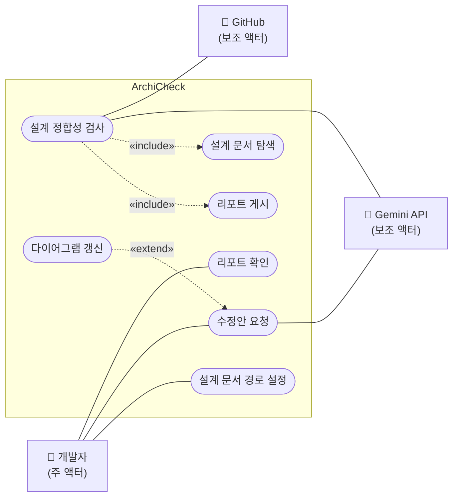
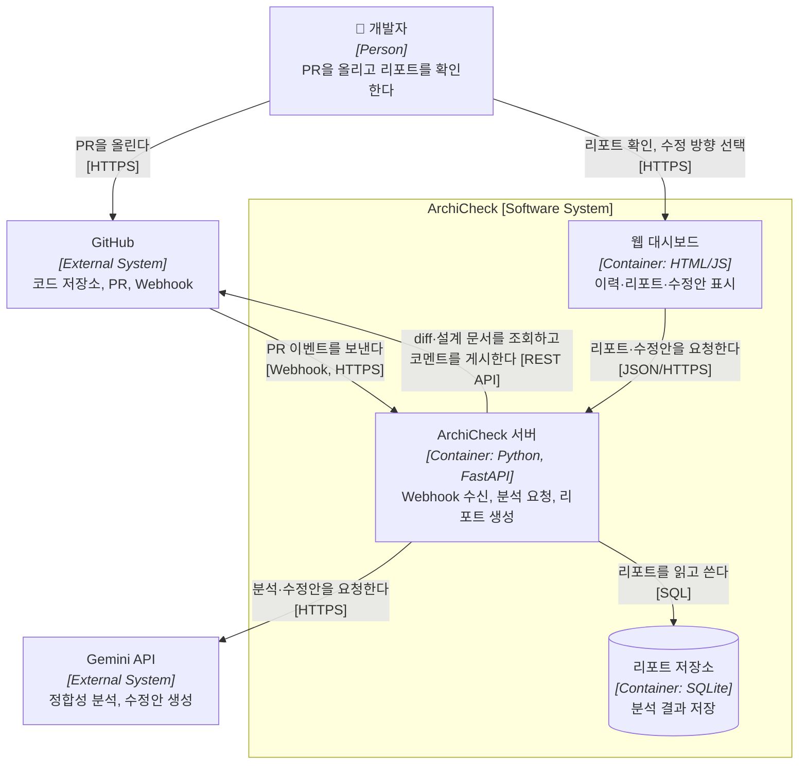
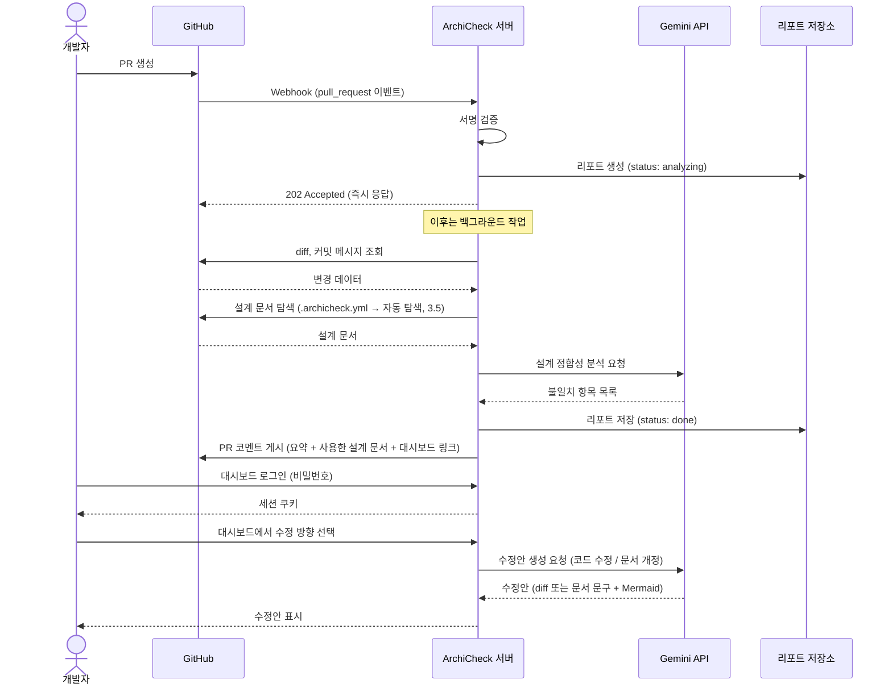
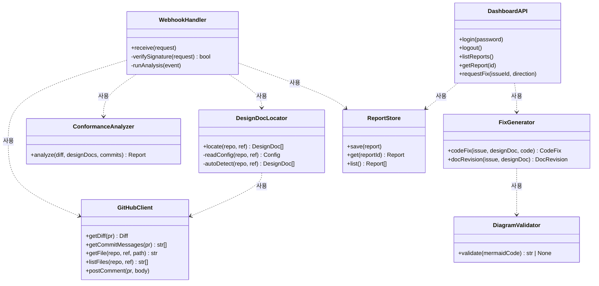

# ArchiCheck 설계 문서


> 코드가 바뀌면 설계 문서·다이어그램과 어긋난 부분을 찾아, 코드 수정 또는 문서 개정안을 제안하는 AI 에이전트

- 개발 기간: 2026.11.16 \~ 11.20 (5일)
- 기술 스택: Python(FastAPI) 서버, HTML/JS 대시보드, SQLite 저장소, Gemini API, NCP

### 문서 이력

| 버전 | 날짜 | 작성자 | 변경 내용 |
| --- | --- | --- | --- |
| v0.1 | 2026.11.16 | 진다혜 | 최초 작성 (요구사항, 아키텍처, 상세 설계 초안) |
| v0.2 | 2026.11.17 | 진다혜 | 3.6 디렉터리 구조 상세화, 담당 역할 표기 |
| v0.3 | 2026.11.17 | 진다혜 | 3.7 역할 분담 추가, 2.4 배포 구성 추가, Webhook 비동기 처리(3.1), 대시보드 로그인 API·인증 규칙(3.4), 설계 문서 탐색 담당 ③ → ② 이동 |
| v0.4 | 2026.11.19 | 진다혜 | AI를 Claude API에서 Gemini API(무료 등급)로 변경: NFR-4·5, 2장 구성도·기술 스택, 2.4 환경 변수(`GEMINI_API_KEY`, `GEMINI_MODEL`), 3.2 설계 원칙, 5장 보안 |
| v0.5 | 2026.11.20 | 진다혜 | ⑤ Mermaid 검증 방식 확정 (Node.js + `mermaid.parse`, jsdom): 2.4 Node.js 항목, 3.2 `DiagramValidator` 설명, 3.7 정해야 할 사항 |
| v0.6 | 2026.11.20 | 진다혜 | 4장 테스트 작성 (단위 테스트 현황, NCP 서버 E2E 결과, 발견한 문제) |
| v0.7 | 2026.11.20 | 진다혜 | 6장 개선 과제 추가 (수정 방향 전환 시 수정안 재생성) |
| v0.8 | 2026.11.21 | 진다혜 | 실제 구현에 맞춰 현행화: 3.6·3.7 PR 코멘트 형식 담당(⑤ → ②), 발표 자료 담당, 4장 테스트 수·E2E 결과·발견한 문제, 6장 개선 과제 5건 추가 |
| v0.9 | 2026.11.21 | 진다혜 | 4.2 E2E 시험 PR 묶음(#18~#22) 결과와 발견한 문제, 6장 개선 과제(분석 정확도·문서 개정 시 코드 전달) 추가, 실패 원인·링크 과제 보강 |

## 1. 요구사항

### 1.1 배경

- 코드는 계속 바뀌지만 설계 문서와 다이어그램은 수동으로 갱신해야 해서 쉽게 낡는다.
- Copilot 등 기존 도구는 코드를 리뷰할 뿐, 설계 문서를 기준으로 비교하거나 문서를 갱신하지 않는다.
- ArchiCheck는 **설계 문서를 기준으로 코드 변경을 검사**하고, 어긋난 부분을 **코드 수정 또는 문서 개정** 중 사용자가 고른 방향으로 고쳐준다.

### 1.2 기능 요구사항

| ID | 기능 | 설명 | 우선순위 |
| --- | --- | --- | --- |
| FR-1 | 변경 감지 | PR 생성·갱신 시 GitHub Webhook으로 변경 이벤트를 받는다 | 필수 |
| FR-2 | 설계 문서 탐색 | 대상 레포의 설계 문서를 찾는다. 설정 파일(`.archicheck.yml`)에 지정된 경로를 우선 사용하고, 없으면 자동 탐색한다 (3.5 참고) | 필수 |
| FR-3 | 설계 정합성 검사 | 변경 코드(diff)와 설계 문서를 비교해 불일치 항목을 찾는다 | 필수 |
| FR-4 | 불일치 리포트 생성 | 불일치 항목마다 위치, 내용, 근거를 담은 리포트를 만든다 | 필수 |
| FR-5 | PR 코멘트 게시 | 리포트 요약과 대시보드 링크를 PR 코멘트로 단다 | 필수 |
| FR-6 | 수정 방향 선택 | 사용자가 불일치 항목마다 \[코드 수정\] 또는 \[문서 개정\]을 고른다 | 필수 |
| FR-7 | 수정안 생성 | 코드 수정안(diff) 또는 문서 개정안(수정 문구 + 갱신된 Mermaid 다이어그램)을 만든다 | 필수 |
| FR-8 | 대시보드 | 분석 이력, 리포트 상세, 수정안을 웹에서 보여준다 | 필수 |
| FR-9 | 보조: 변경 설명 | 커밋 메시지와 실제 변경을 비교해 기능 단위로 설명한다 (FR-3의 근거 자료) | 보조 |
| FR-10 | 보조: 영향 범위 | 변경된 함수·클래스를 참조하는 파일을 찾는다 (FR-3의 근거 자료) | 보조 |
| FR-11 | 확장: Push 커밋 코멘트 | PR 없이 Push만 한 경우 커밋에 코멘트를 단다 | 확장 |

### 1.3 비기능 요구사항

| ID | 항목 | 기준 |
| --- | --- | --- |
| NFR-1 | 응답 시간 | PR 이벤트 수신 후 1분 이내 PR 코멘트 게시 |
| NFR-2 | 안전성 | 코드는 자동 커밋하지 않고 수정안(diff) 제안까지만 한다 |
| NFR-3 | 보안 | API 키·토큰은 `.env`로 관리, Webhook 서명 검증, 대시보드 접근 비밀번호 |
| NFR-4 | 비용 | 무료 범위 내 스택만 사용 (Gemini API 무료 등급, NCP 지원 크레딧) |
| NFR-5 | 안정성 | Mermaid 문법 오류 시 오류 메시지를 Gemini에 전달해 재생성 (최대 2회) |

### 1.4 유스케이스



| 유스케이스 | 액터 | 설명 |
| --- | --- | --- |
| 설계 정합성 검사 | GitHub(시작), Gemini API | PR 이벤트가 오면 변경 코드와 설계 문서를 비교해 불일치를 찾는다 |
| 설계 문서 탐색 | - | 정합성 검사에 항상 포함. 설정 파일 또는 자동 탐색으로 설계 문서를 찾는다 |
| 리포트 게시 | - | 정합성 검사에 항상 포함. 리포트를 저장하고 PR 코멘트를 단다 |
| 리포트 확인 | 개발자 | 대시보드에서 분석 이력과 불일치 항목을 본다 |
| 수정안 요청 | 개발자, Gemini API | 불일치 항목마다 코드 수정 또는 문서 개정을 골라 수정안을 받는다 |
| 다이어그램 갱신 | - | 문서 개정을 골랐고 해당 부분에 다이어그램이 있을 때만 수정안 요청을 확장한다 |
| 설계 문서 경로 설정 | 개발자 | `.archicheck.yml`에 설계 문서 경로를 지정한다 (선택) |

- 표기: 액터와 유스케이스는 화살표 없는 실선, 유스케이스 간 관계는 «include»·«extend» 점선 화살표.
- Mermaid는 UML 유스케이스 다이어그램을 정식 지원하지 않아 flowchart로 UML 표기를 따라 그렸다.

### 1.5 사용자 시나리오

**시나리오 A: 문서가 낡은 경우 → 문서 개정**

1. 개발자가 세션 저장 방식을 메모리에서 DB로 바꾸는 PR을 올린다.
2. ArchiCheck가 "설계 문서의 인증 흐름에 세션 DB 저장 단계가 없음"을 불일치로 찾고 PR에 코멘트를 단다.
3. 개발자가 대시보드에서 해당 항목에 \[문서 개정\]을 고른다.
4. 기존 문구와 수정 문구, 갱신된 시퀀스 다이어그램이 나온다. 개발자는 이를 복사해 설계 문서에 반영한다.

**시나리오 B: 코드가 설계를 어긴 경우 → 코드 수정**

1. 개발자가 `UserService`에서 DB에 직접 쿼리하는 코드를 추가한 PR을 올린다.
2. ArchiCheck가 "설계상 Service는 Repository를 거쳐야 함"을 불일치로 찾는다.
3. 개발자가 \[코드 수정\]을 고르면, Repository를 거치도록 고친 코드 수정안(diff)이 나온다.

## 2. 아키텍처

### 2.1 시스템 구성도 (C4 컨테이너 다이어그램)



- 표기는 C4 모델의 컨테이너 다이어그램 규칙을 따른다. 요소마다 이름, 종류 \[기술\], 역할을 적고, 화살표는 한 방향으로 "무엇을 하는지 \[통신 방식\]"을 적는다.
- 서버, 대시보드, 저장소는 NCP 서버 1대에 함께 배포한다.
- 대시보드 화면 파일(HTML/JS)은 별도 서버 없이 FastAPI 서버가 함께 제공한다.

### 2.2 구성 요소

| 구성 요소 | 역할 |
| --- | --- |
| GitHub Webhook | PR 이벤트를 서버로 전달 |
| ArchiCheck 서버 | 이벤트 수신, diff·설계 문서 수집, Gemini 호출, 리포트 저장, PR 코멘트 게시 |
| Gemini API | 설계 정합성 분석, 수정안·다이어그램 생성 |
| 리포트 저장소 | 분석 결과 저장 (SQLite 파일 1개) |
| 웹 대시보드 | 분석 이력, 리포트 상세, 수정안 패널 표시. 데이터는 서버 API로 받는다 |

### 2.3 기술 스택

| 구분 | 기술 | 선택 이유 |
| --- | --- | --- |
| 서버 | Python + FastAPI | AI 코딩 도구가 잘 다루고, Gemini·GitHub API 라이브러리(google-genai, httpx)가 갖춰져 있음 |
| 저장소 | SQLite | Python 기본 포함, 별도 DB 서버 불필요 |
| 대시보드 | HTML/JS (React 미사용), mermaid.js, diff2html | 화면 3개 규모라 빌드 도구 없이 충분함 |
| AI | Gemini API (Google AI Studio 무료 등급) | 무료 범위에서 쓸 수 있음 (NFR-4). 모델은 `GEMINI_MODEL`로 바꿀 수 있다 |
| 인프라 | 네이버 클라우드 플랫폼(NCP) 서버 1대 |  |
| 연동 | GitHub Webhook, GitHub REST API |  |
| 대체안 | GitHub Actions | NCP 서버 연동이 막히면 Actions에서 분석 실행 |

### 2.4 배포 구성

담당: ① (NCP 서버), ② (GitHub 쪽 설정)

| 항목 | 내용 |
| --- | --- |
| 서버 | NCP 서버 1대에서 `uvicorn server.main:app` 실행. 서버, 대시보드 화면 파일, SQLite 파일이 모두 이 서버에 있다 |
| 공개 주소 | GitHub Webhook을 받을 수 있도록 외부에서 접근 가능한 주소를 둔다. 이 주소를 `PUBLIC_BASE_URL`에 넣는다 |
| Webhook 등록 | ②가 대상 레포에 Webhook을 등록한다. URL은 `{PUBLIC_BASE_URL}/webhook/github`, 이벤트는 `pull_request`, secret은 `GITHUB_WEBHOOK_SECRET`과 같은 값 |
| 환경 변수 | 서버의 `.env`에 둔다. 목록은 아래 표 |
| Node.js | `DiagramValidator`의 Mermaid 문법 검사용. 서버에 Node.js 22.22 이상(mermaid·jsdom 요구 사항, 서버는 24 LTS)을 설치하고 `server/diagram/`에서 `npm ci`를 한 번 실행한다 (①). 없으면 검증을 건너뛰고 경고 로그만 남긴다 |

| 환경 변수 | 설명 | 사용하는 곳 |
| --- | --- | --- |
| `GEMINI_API_KEY` | Gemini API 키 (Google AI Studio에서 발급) | ① `server/analyzer/` |
| `GEMINI_MODEL` | 사용할 Gemini 모델 이름 (선택, 비우면 코드의 기본값) | ① `server/analyzer/` |
| `GITHUB_TOKEN` | GitHub API 토큰 (권한은 5장) | ② `server/github/` |
| `GITHUB_WEBHOOK_SECRET` | Webhook 서명 검증용 secret | ② `server/github/` |
| `DASHBOARD_PASSWORD` | 대시보드 접속 비밀번호 (팀 공용 1개) | ③ 로그인 API |
| `SESSION_SECRET` | 로그인 세션 쿠키 서명 키 (임의의 긴 문자열) | ③ 세션 미들웨어 |
| `PUBLIC_BASE_URL` | 서버 공개 주소. PR 코멘트의 대시보드 링크를 만들 때 쓴다 (예: `http://<서버 IP>:8000`) | ② PR 코멘트 |

## 3. 상세 설계

### 3.1 처리 흐름 (시퀀스 다이어그램)



- **즉시 응답:** GitHub는 Webhook 응답을 10초까지만 기다린다. 서버는 서명 검증과 리포트 생성(`analyzing`)까지만 하고 바로 `202`로 응답한다. 문서 탐색, 분석, 저장, 코멘트 게시는 백그라운드 작업(FastAPI `BackgroundTasks`)으로 실행한다.
- **처리 순서 담당:** 위 백그라운드 흐름은 `WebhookHandler`(②)가 차례로 호출해 엮는다. 각 단계 모듈은 3.7의 담당자가 만든다.
- **실패 처리:** 백그라운드 작업 중 오류가 나면 리포트 `status`를 `failed`로 바꾸고, PR에 "분석 실패" 코멘트를 단다.
- **같은 PR 재분석:** PR에 새 커밋이 올라오면(`synchronize` 이벤트) 새 `headSha`로 리포트를 하나 더 만든다. 이전 리포트는 이력으로 남긴다.

### 3.2 서버 모듈 구조 (클래스 다이어그램)



- 관계는 모두 의존(점선 화살표): 다른 모듈을 객체로 소유하지 않고 호출만 한다.
- 설계 원칙: Gemini API 호출은 `ConformanceAnalyzer`와 `FixGenerator`에서만 한다. 두 모듈은 공통 도우미 `server/analyzer/llm_call.py`를 거쳐 호출한다.
- 설계 원칙: GitHub API 호출은 `GitHubClient`에서만 한다.
- `WebhookHandler.runAnalysis`는 3.1의 백그라운드 흐름(탐색 → 분석 → 저장 → 코멘트)을 실행한다.
- `ConformanceAnalyzer.analyze(diff, designDocs, commits)`의 입출력:
  - 입력: `diff`는 PR의 unified diff 텍스트, `designDocs`는 `[{ "path": "...", "content": "..." }]`(`DesignDocLocator.locate` 결과), `commits`는 커밋 메시지 문자열 목록.
  - 반환: 3.3 리포트 중 분석 필드 `designDocs`, `summary`, `impact`, `issues`만 담은 dict. `issues[].id`는 `iss_1`부터 붙이고 `direction`, `fix`는 `null`이다. 나머지 필드(`id`, `repo`, `pr`, `headSha`, `title`, `createdAt`, `status`)는 `WebhookHandler`가 채워 합친다.
  - 실패하면 `AnalysisError`를 던진다. `WebhookHandler`는 이를 받아 리포트 `status`를 `failed`로 바꾼다 (3.1 실패 처리).
- `FixGenerator`의 입출력:
  - `codeFix(issue, designDoc, code)`: `issue`는 3.3 `issues[]` 항목, `designDoc`은 `designRef` 경로(`#` 앞) 문서 전문, `code`는 `codeRef` 파일 전문. 반환 `{ "diff": "..." }`.
  - `docRevision(issue, designDoc)`: 반환 `{ "before": "...", "after": "...", "mermaid": "..." | null }`. `before`는 설계 문서에 있는 문구 그대로다.
  - 문서·코드 전문은 `DashboardAPI`가 `GitHubClient.getFile(repo, headSha, 경로)`로 가져와 넘긴다.
  - 실패하면 `FixError`를 던진다. Mermaid 문법 오류가 재생성 2회 뒤에도 남으면 실패로 본다 (NFR-5).
- `DiagramValidator.validate(mermaidCode)`는 문법이 맞으면 `None`, 틀리면 오류 메시지 문자열을 돌려준다. 오류 메시지는 `FixGenerator`가 재생성 요청에 넣는다 (NFR-5).
  - 검사 방식: Node.js로 `server/diagram/mermaid_validate.mjs`를 실행해 `mermaid.parse()`로 문법만 검사한다. 브라우저 화면(DOM)은 jsdom으로 대신하므로 크롬이 필요 없고, 대시보드의 mermaid.js와 같은 파서를 쓴다.
  - Node.js·npm 패키지가 없거나 검사기 자체가 실패하면 `None`(통과)으로 처리하고 경고 로그를 남긴다. 환경 문제로 수정안 생성 전체가 멈추지 않게 하기 위함이다.

### 3.3 리포트 데이터 형식 (JSON)

서버와 대시보드를 연결하는 기준 형식이다. 형식과 예시 파일(`samples/report.json`)은 ①이 관리한다. 필드를 추가·변경하려면 ①과 먼저 협의하고, 이 문서와 예시 파일을 먼저 고친 뒤 구현한다.

```json
{
  "id": "rpt_12_a1b2c3",
  "repo": "owner/target-repo",
  "pr": 12,
  "headSha": "a1b2c3d",
  "title": "로그인 버그 수정",
  "createdAt": "2026-11-18T14:20:00+09:00",
  "status": "done",
  "designDocs": ["docs/architecture.md"],
  "summary": {
    "commitMessage": "로그인 버그 수정",
    "actualChanges": ["로그인 실패 처리 수정", "세션 저장 방식 변경(메모리 → DB)"],
    "unmentionedChanges": 1
  },
  "impact": [
    { "file": "src/auth/AuthController.java", "symbol": "refresh()", "reason": "변경된 세션 로직과 맞지 않음" }
  ],
  "issues": [
    {
      "id": "iss_1",
      "title": "인증 흐름 문서에 세션 DB 저장 단계 없음",
      "designRef": "docs/architecture.md#인증 흐름",
      "codeRef": "src/auth/SessionStore.java",
      "detail": "코드는 세션을 DB에 저장하지만 시퀀스 다이어그램에는 해당 단계가 없음",
      "direction": null,
      "fix": null
    }
  ]
}
```

| 필드 | 설명 |
| --- | --- |
| `headSha` | 분석한 PR의 마지막 커밋 |
| `status` | `analyzing`(분석 중) / `done`(분석 완료) / `resolved`(불일치 항목이 있고 모두 조치 완료) / `failed`(분석 실패) |
| `designDocs` | 비교에 사용한 설계 문서 경로 (3.5 탐색 결과) |
| `summary`, `impact` | 보조 기능(FR-9, FR-10) 결과. 비어 있어도 된다 |
| `issues[].direction` | 사용자 선택 전 `null`, 선택 후 `code` 또는 `doc` |
| `issues[].resolved` | 항목의 조치 완료 여부를 나타내는 선택 필드입니다. 값이 없으면 리포트가 `resolved`일 때 완료로, 그 외에는 미완료로 표시합니다. |
| `issues[].designRef` | 불일치 근거가 된 설계 문서 경로와 섹션 (문서 이름은 레포마다 다름) |
| `issues[].fix` | 선택 후 생성된 수정안. `code`면 `{ "diff": "..." }`, `doc`이면 `{ "before": "...", "after": "...", "mermaid": "..." }` (다이어그램이 없으면 `mermaid`는 `null`) |

### 3.4 서버 API

| 메서드 | 경로 | 인증 | 설명 |
| --- | --- | --- | --- |
| GET | `/health` | 없음 | 서버 상태 확인. `{ "status": "ok" }` |
| POST | `/webhook/github` | 서명 검증 | GitHub Webhook 수신. 서명이 틀리면 `401`, 정상이면 `202` 후 백그라운드 분석 (3.1) |
| POST | `/api/login` | 없음 | 요청 본문 `{ "password": "..." }`. 맞으면 `200`과 세션 쿠키, 틀리면 `401` |
| POST | `/api/logout` | 세션 | 세션 쿠키 삭제 |
| GET | `/api/reports` | 세션 | 분석 이력 목록 |
| GET | `/api/reports/{id}` | 세션 | 리포트 상세 |
| POST | `/api/reports/{id}/issues/{issueId}/fix` | 세션 | 수정 방향 선택 및 수정안 생성. 요청 본문은 `{ "direction": "code" }` 또는 `{ "direction": "doc" }`이며, 응답에 `direction`, `fix`, `status`를 담습니다. |
| PUT | `/api/reports/{id}/issues/{issueId}/resolution` | 세션 | 항목의 완료 또는 취소 상태를 저장합니다. 완료 요청은 `{ "resolved": true, "reviewed": { "direction": "code", "fix": { "diff": "..." } } }`, 취소 요청은 `{ "resolved": false }`입니다. 성공하면 리포트 `status`와 항목별 완료 여부를 담은 `resolutions`를 반환합니다. 완료 요청의 수정안이 누락됐거나 저장된 수정안과 다르면 `409`를 반환합니다. |

항목별로 수정안을 확인한 뒤 **조치 완료**를 누르거나 완료된 항목에서 **조치 완료 취소**를 누를 수 있습니다. 수정안 생성과 완료 상태 변경은 각각 저장합니다. 상세 화면과 분석 이력은 저장된 항목 상태를 바탕으로 완료 건수를 표시합니다.

#### 대시보드 인증

팀 공용 비밀번호 1개로 접속하는 **로그인 API + 세션 쿠키** 방식을 쓴다.

- **선택 이유:** 대시보드 화면은 FastAPI가 같은 주소에서 제공하므로(2.1) 쿠키가 모든 요청에 자동으로 붙는다. PR 코멘트의 리포트 링크로 바로 들어와도, 로그인 후 원래 보던 페이지로 돌아갈 수 있다. HTTP 기본 인증은 로그인 화면을 만들 수 없고 로그아웃이 안 돼서 쓰지 않는다.
- **서버 (③):** Starlette `SessionMiddleware`(`SESSION_SECRET`으로 서명)를 쓴다. 쿠키는 `HttpOnly`, `SameSite=Lax`로 설정한다. 비밀번호는 `hmac.compare_digest`로 `DASHBOARD_PASSWORD`와 비교한다. 세션이 없으면 표의 "세션" 항목은 `401`을 돌려준다.
- **화면 (④):** API가 `401`을 주면 로그인 화면으로 보낸다. 이때 원래 주소를 기억해 두었다가 로그인 성공 후 그 주소로 돌아간다.
- **인증 제외:** `/health`, `/webhook/github`(서명 검증으로 대신), `/api/login`, 로그인 화면 파일.

### 3.5 설계 문서 탐색 규칙

담당: ② (`DesignDocLocator`). 설계 문서 이름과 위치는 레포마다 다르므로 아래 순서로 찾는다.

1. **설정 파일:** 대상 레포 루트에 `.archicheck.yml`이 있으면 지정된 경로를 사용한다.
2. **자동 탐색:** 설정 파일이 없으면 파일 이름에 `design`, `architecture`, `arch`, `설계`, `아키텍처`가 포함되거나, 본문에 Mermaid 코드 블록이 포함된 `.md` 파일을 찾는다.
3. **결과 공개:** 사용한 설계 문서 경로를 PR 코멘트에 밝힌다. 찾지 못하면 "설계 문서를 찾지 못함, `.archicheck.yml`로 지정 필요"라고 안내한다.

`.archicheck.yml` 예시:

```yaml
design_docs:
  - docs/architecture.md
  - docs/설계서.md
```

### 3.6 디렉터리 구조

```
archicheck/
├─ docs/
│  └─ DESIGN.md          이 문서                                       ①
├─ server/
│  ├─ main.py            FastAPI 앱 시작점, 세션 미들웨어               ③
│  ├─ analyzer/          ConformanceAnalyzer, FixGenerator             ①
│  ├─ github/            WebhookHandler, GitHubClient, DesignDocLocator ②
│  ├─ api/               DashboardAPI (로그인 포함)                     ③
│  ├─ store/             ReportStore (SQLite)                          ③
│  └─ diagram/           DiagramValidator                              ⑤
├─ dashboard/            분석 이력·리포트 상세·로그인 화면 ④, 수정안 패널 ⑤
├─ prompts/              AI 프롬프트                                    ①
├─ samples/
│  └─ report.json        3.3 형식의 예시 리포트 (개발용 가짜 데이터)    ①
├─ requirements.txt                                                    ①
├─ .env.example          환경 변수 예시 (실제 키는 .env에 두고 올리지 않음) ①
├─ .gitignore                                                          ①
├─ CLAUDE.md             Claude Code 작업 규칙                          ①
└─ README.md                                                           ①
```

- 오른쪽 번호는 담당 역할이다. 역할별 담당자와 업무는 3.7을 따른다.
- 각자 자기 폴더만 수정한다. 다른 폴더를 고쳐야 하면 해당 담당자와 먼저 이야기한다.
- 루트 파일(`requirements.txt`, `.env.example` 등)에 패키지나 환경 변수를 추가해야 하면 ①에게 요청하거나, PR에 함께 올려 ①의 리뷰를 받는다.

### 3.7 역할 분담

| 번호 | 담당자 | 역할 | 담당 업무 | 담당 파일·폴더 |
| --- | --- | --- | --- | --- |
| ① | 진다혜 | 팀장·AI 분석 | 정합성 분석·수정안 생성(Gemini 호출, 프롬프트), NFR-5 다이어그램 재생성 루프, 리포트 JSON 형식 관리(3.3), PR 리뷰·Merge, 문서 관리, NCP 서버 배포(2.4), 발표 자료 | `server/analyzer/`, `prompts/`(AI 프롬프트), `samples/`, `docs/`, 루트 파일 |
| ② | 신유찬 | GitHub 연동 | Webhook 수신·서명 검증, GitHub API(diff·커밋 메시지·파일 조회, PR 코멘트 게시), PR 코멘트 형식(`server/github/comment.py`), 설계 문서 탐색(3.5), 분석 처리 순서 연결과 백그라운드 실행(3.1), 대상 레포 Webhook 등록·토큰 발급(2.4), E2E 테스트(4장), (확장) FR-11 Push 커밋 코멘트 | `server/github/` |
| ③ | 윤정은 | 서버 API·저장 | FastAPI 기본 구조, 대시보드 화면 파일 제공, SQLite 저장, 대시보드용 API(3.4), 로그인·세션 인증(서버 쪽) | `server/main.py`, `server/api/`, `server/store/` |
| ④ | 주성빈 | 대시보드 화면 | 분석 이력·리포트 상세 화면, 서버 API 연결, 로그인 화면과 `401` 처리 | `dashboard/` (수정안 패널 제외) |
| ⑤ | 장경호 | 시각화·발표 | 수정안 패널(diff2html로 코드 diff, mermaid.js로 다이어그램 표시), Mermaid 문법 검증, 시연·발표 | `server/diagram/`, `dashboard/` 수정안 패널(`fix-panel.js`, `fix-panel.css`) |

역할 사이의 연결 지점:

| 연결 | 내용 | 기준 |
| --- | --- | --- |
| ② → ①③ | `WebhookHandler`가 `DesignDocLocator`(②) → `ConformanceAnalyzer`(①) → `ReportStore`(③) 순서로 호출하고 코멘트를 게시한다 | 3.1, 3.2 |
| ① ↔ ③④⑤ | 리포트 JSON 형식. ④⑤는 서버 완성 전에 `samples/report.json`으로 화면을 먼저 만든다 | 3.3 |
| ③ ↔ ④ | 대시보드 API와 로그인·`401` 처리 | 3.4 |
| ① → ⑤ | `FixGenerator`가 `DiagramValidator`로 Mermaid를 검증하고, 실패하면 오류 메시지를 넣어 재생성한다 (최대 2회) | NFR-5 |
| ② → ③④ | ②가 PR 코멘트에 리포트 요약과 대시보드 링크(`{PUBLIC_BASE_URL}/dashboard/report.html?id=...`)를 넣어 게시한다. 링크는 ③이 제공하고 ④가 만든 리포트 상세 화면으로 열린다 | 2.4 |
| ④ ↔ ⑤ | ④의 리포트 상세 화면이 `window.renderFixPanel(issue, element)`를 호출하면 ⑤의 수정안 패널이 그린다 | 3.3 `issues[].fix` |

정해야 할 사항:

- **⑤ Mermaid 검증 방식 (확정, v0.5):** mermaid-cli는 크롬을 띄워야 해서 무겁기 때문에 쓰지 않고, Node.js에서 `mermaid.parse()`를 jsdom과 함께 호출한다 (3.2). Node.js 설치와 `npm ci`는 ①이 NCP 서버에서 한다 (2.4).

## 4. 테스트

담당: ② (E2E 테스트), 각 담당자 (자기 모듈 단위 테스트)

### 4.1 단위 테스트

각 담당자가 자기 모듈의 단위 테스트를 작성한다. 외부 서비스(Gemini, GitHub)는 가짜 객체로 바꿔 실제로 호출하지 않는다.

| 대상 | 실행 | 테스트 수 (2026.11.21) |
| --- | --- | --- |
| 서버 (`server/` 전체) | `pytest` | 145 |
| 대시보드 화면 (`dashboard/app.js`) | `node --test dashboard/tests/app.test.js` | 30 |
| 수정안 패널 (`dashboard/fix-panel.js`) | `node --test dashboard/tests/fix-panel.test.js` | 11 |

- `server/diagram` 테스트 8개는 `server/diagram`에서 `npm ci`를 한 환경에서만 실행되고, 아니면 건너뛴다.

### 4.2 E2E 테스트

NCP 서버(2.4)에 배포한 상태로, 대상 레포에 실제 PR을 올려 Webhook 수신부터 수정안 표시까지 확인한다.

- 대상 레포: `Jindahye/archicheck` (이 레포 자체, 설계 문서는 이 문서)
- 서버: `http://211.233.210.29:8000`, Gemini 모델 `gemini-3.5-flash-lite`

시험 PR은 모두 merge하지 않는다. 시험 브랜치의 커밋 메시지는 실제 개발처럼 쓴다 (AI가 커밋 메시지도 읽기 때문).

| 시나리오 | 시험 PR | 결과 |
| --- | --- | --- |
| A1. 문서가 낡은 경우: 클래스 다이어그램 | #18: 새 클래스 `AnalysisCache`를 추가하고 `ConformanceAnalyzer`가 사용 (3.2 다이어그램에 없음) | 통과 (프롬프트 보강 후). 처음에는 0건. 다이어그램 대조 기준을 프롬프트에 넣은 뒤 2건("클래스 다이어그램에 AnalysisCache 누락", "관계 누락")을 찾음. 문서 개정안으로 `AnalysisCache`가 추가된 classDiagram이 생성되고 Mermaid 문법 검증을 통과함 |
| A2. 문서가 낡은 경우: 시퀀스 다이어그램 | #19: 정합성 분석을 Gemini 1회 호출에서 2회 호출(요약 → 분석)로 변경 (3.1 다이어그램은 1회) | 실패. 프롬프트 보강 후에도 불일치 0건 |
| B. 코드가 설계를 어긴 경우 | #15: `server/analyzer/`에서 httpx로 GitHub API를 직접 호출 (3.2 "GitHub API 호출은 `GitHubClient`에서만" 위반) | 통과. 불일치 1건("GitHub API 호출은 GitHubClient 모듈을 거쳐야 함")을 찾음. PR 코멘트 게시, 대시보드 표시, 코드 수정안·문서 개정안 생성 확인 |
| B2. 한 파일에서 원칙 3개 위반 | #20: 새 모듈이 SQLite 직접 저장(`ReportStore` 우회), GitHub API 직접 호출, Gemini 직접 호출(`llm_call.py` 우회) | 일부 통과. 위반을 찾았지만 1건으로 묶었고, Gemini 직접 호출은 따로 짚지 못함 |
| C. 설계를 지킨 변경 | #16(대시보드 CSS 수정), #17(수정안 패널 추가): 팀원이 올린 실제 PR | 통과. 두 PR 모두 불일치 0건, PR 코멘트에 변경 설명과 대시보드 링크 게시 |
| D. 커밋 메시지와 실제 변경이 다름 | #21: 커밋 메시지는 "docs: 주석 오타 수정"인데 기본 모델, 재시도 횟수, 시간 제한도 바꿈 | 통과. 변경 요약에 "커밋 메시지에 없는 변경 3건" 경고. 바뀐 모델이 이 문서와 다르다는 불일치 1건도 찾음 |
| E. 분석 실패 | #22: `.archicheck.yml`이 없는 문서(`docs/ARCHITECTURE.md`)를 가리킴 | 통과. 리포트 `failed`, PR에 실패 코멘트, 대시보드에 실패 안내. 단 코멘트에 원인이 없음 (아래 발견한 문제) |

확인한 단계 (시나리오 B):

1. Webhook 수신과 서명 검증 (`202`)
2. 설계 문서 탐색, Gemini 분석, 리포트 저장
3. PR 코멘트 게시 (요약, 영향 범위, 불일치 목록, 대시보드 링크)
4. 대시보드 로그인, 리포트 상세 표시
5. 수정 방향 선택과 수정안 생성 (`POST .../fix` `200`)

발견한 문제:

| 문제 | 원인 | 조치 |
| --- | --- | --- |
| 수정안이 JSON 글자로 표시됨 | ⑤ 수정안 패널(`renderFixPanel`) 미완성 | ⑤ 수정안 패널 완성 (PR #17) |
| 문서 개정안의 긴 문장이 가로 스크롤로 잘려 바뀐 부분이 안 보임. 어두운 테마에서 바뀐 줄 색이 거의 안 보임 | 문서 문구에 코드처럼 `white-space: pre` 적용. 어두운 테마의 강조 배경색이 너무 어두움 | 문서 문구는 줄바꿈, 어두운 테마에서만 강조색을 진하게 (①, ⑤ 승인) |
| 수정안을 만드는 10~30초 동안 이전 수정안이 그대로 보여 멈춘 것처럼 보임 | 진행 표시가 버튼 옆 작은 글자뿐 | 수정안 자리에 스피너와 안내 문구 표시, 이미 고른 방향은 다시 요청하지 않음 (①, ④ 승인) |
| 긴 줄이 있으면 불일치 카드가 오른쪽 칸을 침범 | `.issue` grid에 열 너비 지정 없음 | ④ `grid-template-columns: minmax(0, 1fr)` 추가 |
| 수정안 요청 1회가 `502`로 실패, 다시 누르니 성공 | Gemini `503`(일시적 수요 과다) | `llm_call.py`에서 429·500·503을 최대 3번 시도하도록 수정 (①) |
| 설계 문서로 `README.md`, `prompts/doc_revision.md`도 함께 사용됨 | 자동 탐색(3.5)이 Mermaid 블록이 있는 md를 모두 포함 | 레포 루트에 `.archicheck.yml`을 두어 `docs/DESIGN.md`만 지정 (①) |
| 문서가 낡은 경우(다이어그램에 없는 새 구성 요소)를 찾지 못함 (A1) | 분석 프롬프트에 다이어그램과 대조하는 구체적 기준이 없고 "확신이 없으면 넣지 않는다"는 규칙 때문에 보수적으로 판단 | 프롬프트에 새 구성 요소·처리 흐름 변경·설계 원칙 기준과 "원칙 하나당 한 항목" 규칙 추가 (①). A1은 해결 |
| 처리 흐름 변경(A2)을 찾지 못하고, 여러 위반을 한 항목으로 묶음(B2) | 프롬프트 보강 후에도 같음. 가벼운 모델(`gemini-3.5-flash-lite`)의 한계로 판단 | 미해결. 6장 개선 과제 |
| 문서 개정안 다이어그램에 실제와 다른 메서드가 들어감 (A1: 실제 `key/get/put`, 다이어그램 `get/set/clear`) | `docRevision(issue, designDoc)`은 코드를 받지 않아 AI가 실제 메서드를 알 수 없음 (3.2) | 미해결. 6장 개선 과제 |
| 분석 실패 PR 코멘트에 원인이 없음 (E) | 실패 코멘트가 원인과 관계없이 "서버 로그에서 확인"만 안내. 3.5의 "설계 문서를 찾지 못함, `.archicheck.yml`로 지정 필요" 안내와 다름 | ②에게 요청 (실패 종류별 안내 문구) |
| 대시보드의 설계 문서 섹션 링크가 해당 위치로 가지 않음 | AI가 `#3.2 서버 모듈 구조 (클래스 다이어그램)`처럼 제목 전체를 주지만, 링크로 바꿀 때 점·괄호를 지우지 않아 GitHub 앵커와 다름 | 미해결. 6장 개선 과제 |

## 5. 보안 및 한계

- API 키·GitHub 토큰은 `.env`에 보관하고 `.gitignore`에 추가한다.
- GitHub 토큰은 대상 레포 하나에만 최소 권한을 준다: Contents 읽기(설계 문서·파일 조회), Pull requests 읽기·쓰기(diff 조회, PR 코멘트 게시).
- Webhook secret을 설정하고 서버에서 서명(`X-Hub-Signature-256`)을 검증한다.
- 대시보드는 비밀번호 로그인과 세션 쿠키로 보호한다 (3.4).
- 서버에 HTTPS가 없으면 로그인 비밀번호와 세션 쿠키가 암호화 없이 전송된다. 시연용 한계로 두고, 비밀번호는 다른 곳에 쓰지 않는 값으로 정한다.
- 분석을 위해 코드와 설계 문서가 Gemini API로 전송된다. 무료 등급에서는 보낸 내용이 Google의 모델 개선에 쓰일 수 있으므로, 공개해도 되는 코드만 분석 대상으로 한다.
- AI 분석 결과는 틀릴 수 있으므로 수정안은 제안까지만 하고 사람이 확인 후 반영한다.

## 6. 개선 과제

발표 이후 개선할 점. 지금 범위에서는 고치지 않는다.

| 과제 | 현재 동작 | 개선 방향 | 영향 범위 |
| --- | --- | --- | --- |
| 수정 방향을 바꾸면 수정안을 다시 생성함 | 불일치 항목마다 `direction`, `fix`를 하나만 저장한다 (3.3). 같은 방향을 다시 고르면 저장된 수정안을 돌려주지만, 방향을 바꾸면 이전 수정안을 버리고 Gemini로 새로 만든다. 그래서 [코드 수정]과 [문서 개정]을 번갈아 고르면 매번 AI를 호출해 기다려야 하고, 결과도 매번 조금씩 달라질 수 있다 | 방향별 수정안을 모두 저장하고(예: `fixes: { "code": ..., "doc": ... }`), `direction`은 현재 선택만 나타낸다. 이미 만든 방향으로 돌아가면 저장된 수정안을 바로 보여 준다 | 3.3 리포트 형식(①), `samples/report.json`(①), 3.4 수정안 API(③), 리포트 상세·수정안 패널(④⑤) |
| 분석 실패 원인을 알 수 없음 | 리포트에 `status: "failed"`만 저장한다. PR 코멘트는 "서버 로그에서 확인"만 안내하고(4.2 E), 대시보드는 설계 문서 누락과 AI 오류를 구분하지 못해 두 가능성을 모두 안내한다 | 실패를 종류(설계 문서 없음, AI 오류, 기타)로 나눠 리포트에 저장하고(예: `error: "no_design_doc"`), PR 코멘트와 대시보드가 종류별 안내 문구를 보여 준다. 공개 PR에는 예외 메시지 원문을 쓰지 않는다 | 3.3 리포트 형식(①), 분석 처리·PR 코멘트(②), 리포트 상세(④) |
| 설계 문서·코드 링크가 정확한 위치로 가지 않음 | `designRef`는 `경로#섹션 이름`, `codeRef`는 파일 경로만 있다. 대시보드가 섹션 이름을 링크로 바꿀 때 점·괄호를 지우지 않아 GitHub 앵커와 다르고(E2E에서 확인, 4.2), 코드는 파일 맨 위가 열린다 | 당장은 GitHub 앵커 규칙(소문자, 공백 → `-`, 점·괄호 등 문장 부호 삭제)대로 바꾼다. 나중에는 AI가 줄 번호도 함께 돌려주게 하고 `#L228`처럼 줄로 연결한다 | 리포트 상세(④), 3.3 리포트 형식·분석 프롬프트(①) |
| 일부 불일치를 찾지 못함 | 처리 흐름 변경(시퀀스 다이어그램)을 놓치고, 여러 원칙 위반을 한 항목으로 묶는다 (4.2 A2, B2). 프롬프트 보강으로도 해결되지 않았다 | 분석에는 더 정확한 모델(예: `gemini-3.5-flash`)을 쓰고 수정안 생성에는 가벼운 모델을 쓰는 식으로 용도별 모델을 나눈다. 무료 등급 한도가 줄어드는 점을 함께 따진다. 시험 PR 묶음(4.2)을 회귀 시험으로 남겨 프롬프트·모델을 바꿀 때마다 다시 돌린다 | `llm_call.py`·분석 프롬프트(①), 2.4 환경 변수 |
| 문서 개정안 다이어그램에 실제 코드와 다른 내용이 들어감 | `docRevision(issue, designDoc)`은 코드를 받지 않는다 (3.2). 새 클래스를 다이어그램에 넣을 때 AI가 메서드 이름을 추측한다 (4.2 A1) | `docRevision`에 `codeRef` 파일 전문도 넘겨 실제 코드에 맞춰 다이어그램을 고치게 한다. 같은 다이어그램에 대한 불일치 여러 건(예: 클래스 누락, 관계 누락)은 한 번에 개정한다 | 3.2 `FixGenerator`·개정 프롬프트(①), 3.4 수정안 API(③) |
| 다이어그램 전후 비교가 없음 | 문서 개정안(`fix`)에는 수정 후 Mermaid만 있어 수정 후 그림만 보여 준다 | `fix`에 수정 전 다이어그램(예: `mermaidBefore`)을 추가해 나란히 보여 준다 | 3.3 리포트 형식·개정 프롬프트(①), 수정안 패널(⑤) |
| 문장 안에서 바뀐 단어가 표시되지 않음 | 문서 개정안을 줄 단위로만 비교해, 한 줄에서 몇 단어만 바뀌어도 줄 전체가 바뀐 것으로 표시된다 | 바뀐 줄 안에서 단어 단위로 한 번 더 비교해 바뀐 단어만 강조한다 | 수정안 패널(⑤) |
| 우리 팀 레포에서만 쓸 수 있음 | 서버 하나가 개인 토큰 1개, Webhook secret 1개, 대시보드 비밀번호 1개를 쓴다. 레포마다 Webhook을 손으로 등록하고, 비밀번호를 아는 사람은 모든 리포트를 본다 | 누구나 쓰려면: GitHub App으로 바꿔 설치만으로 연결하고 설치별 토큰을 쓴다. GitHub 로그인(OAuth)으로 권한이 있는 레포의 리포트만 보여 준다. 리포트를 레포·설치별로 나눠 저장한다. 남의 코드를 다루므로 학습에 쓰이지 않는 Gemini 유료 등급과 레포별 사용량 제한, 도메인·HTTPS가 필요하다. 더 가벼운 대안은 GitHub Action으로 배포해 사용자가 자기 Gemini 키로 자기 레포 CI에서 돌리는 방식(2.3 대체안)이다 | 전체 (2장 구성, 3.4 인증, 5장 보안) |
