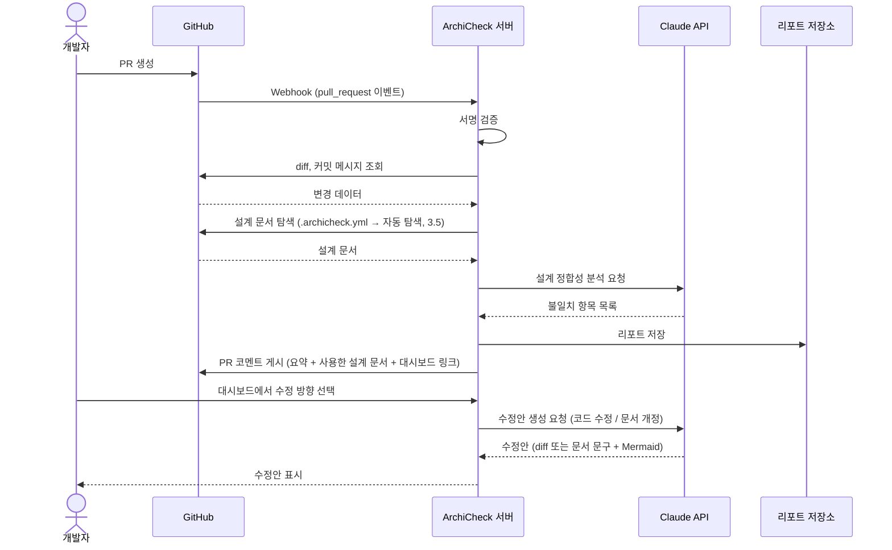
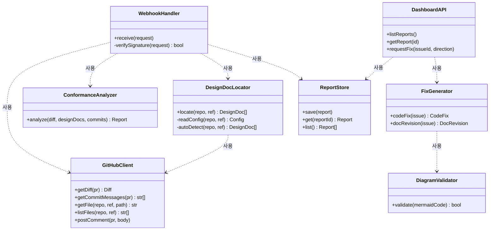

# ArchiCheck 설계 문서

Nov 16, 2026 · @dahye

> 코드가 바뀌면 설계 문서·다이어그램과 어긋난 부분을 찾아, 코드 수정 또는 문서 개정안을 제안하는 AI 에이전트

- 개발 기간: 2026.11.16 \~ 11.20 (5일)
- 기술 스택: Python(FastAPI) 서버, HTML/JS 대시보드, SQLite 저장소, Claude API, NCP

### 문서 이력

| 버전 | 날짜 | 작성자 | 변경 내용 |
| --- | --- | --- | --- |
| v0.1 | 2026.11.16 | 진다혜 | 최초 작성 (요구사항, 아키텍처, 상세 설계 초안) |
| v0.2 | 2026.11.17 | 진다혜 | 3.6 디렉터리 구조 상세화, 담당 역할 표기 |

## 1. 요구사항

### 1.1 배경

- 코드는 계속 바뀌지만 설계 문서와 다이어그램은 수동으로 갱신해야 해서 쉽게 낡는다.
- Copilot 등 기존 도구는 코드를 리뷰할 뿐, 설계 문서를 기준으로 비교하거나 문서를 갱신하지 않는다.
- ArchiCheck는 **설계 문서를 기준으로 코드 변경을 검사**하고, 어긋난 부분을 **코드 수정 또는 문서 개정** 중 사용자가 고른 방향으로 고쳐준다.

### 1.2 기능 요구사항

| ID | 기능 | 설명 | 우선순위 |
| --- | --- | --- | --- |
| FR-1 | 변경 감지 | PR 생성·갱신 시 GitHub Webhook으로 변경 이벤트를 받는다 | 필수 |
| FR-2 | 설계 문서 탐색 | 대상 레포의 설계 문서를 찾는다. 설정 파일(`.archicheck.yml`)에 지정된 경로를 우선 사용하고, 없으면 자동 탐색한다 (3.5 참고) | 필수 |
| FR-3 | 설계 정합성 검사 | 변경 코드(diff)와 설계 문서를 비교해 불일치 항목을 찾는다 | 필수 |
| FR-4 | 불일치 리포트 생성 | 불일치 항목마다 위치, 내용, 근거를 담은 리포트를 만든다 | 필수 |
| FR-5 | PR 코멘트 게시 | 리포트 요약과 대시보드 링크를 PR 코멘트로 단다 | 필수 |
| FR-6 | 수정 방향 선택 | 사용자가 불일치 항목마다 \[코드 수정\] 또는 \[문서 개정\]을 고른다 | 필수 |
| FR-7 | 수정안 생성 | 코드 수정안(diff) 또는 문서 개정안(수정 문구 + 갱신된 Mermaid 다이어그램)을 만든다 | 필수 |
| FR-8 | 대시보드 | 분석 이력, 리포트 상세, 수정안을 웹에서 보여준다 | 필수 |
| FR-9 | 보조: 변경 설명 | 커밋 메시지와 실제 변경을 비교해 기능 단위로 설명한다 (FR-3의 근거 자료) | 보조 |
| FR-10 | 보조: 영향 범위 | 변경된 함수·클래스를 참조하는 파일을 찾는다 (FR-3의 근거 자료) | 보조 |
| FR-11 | 확장: Push 커밋 코멘트 | PR 없이 Push만 한 경우 커밋에 코멘트를 단다 | 확장 |

### 1.3 비기능 요구사항

| ID | 항목 | 기준 |
| --- | --- | --- |
| NFR-1 | 응답 시간 | PR 이벤트 수신 후 1분 이내 PR 코멘트 게시 |
| NFR-2 | 안전성 | 코드는 자동 커밋하지 않고 수정안(diff) 제안까지만 한다 |
| NFR-3 | 보안 | API 키·토큰은 `.env`로 관리, Webhook 서명 검증, 대시보드 접근 비밀번호 |
| NFR-4 | 비용 | 무료 범위 내 스택만 사용 (Claude API 실습 계정, NCP 지원 크레딧) |
| NFR-5 | 안정성 | Mermaid 문법 오류 시 오류 메시지를 Claude에 전달해 재생성 (최대 2회) |

### 1.4 유스케이스


| 유스케이스 | 액터 | 설명 |
| --- | --- | --- |
| 설계 정합성 검사 | GitHub(시작), Claude API | PR 이벤트가 오면 변경 코드와 설계 문서를 비교해 불일치를 찾는다 |
| 설계 문서 탐색 | - | 정합성 검사에 항상 포함. 설정 파일 또는 자동 탐색으로 설계 문서를 찾는다 |
| 리포트 게시 | - | 정합성 검사에 항상 포함. 리포트를 저장하고 PR 코멘트를 단다 |
| 리포트 확인 | 개발자 | 대시보드에서 분석 이력과 불일치 항목을 본다 |
| 수정안 요청 | 개발자, Claude API | 불일치 항목마다 코드 수정 또는 문서 개정을 골라 수정안을 받는다 |
| 다이어그램 갱신 | - | 문서 개정을 골랐고 해당 부분에 다이어그램이 있을 때만 수정안 요청을 확장한다 |
| 설계 문서 경로 설정 | 개발자 | `.archicheck.yml`에 설계 문서 경로를 지정한다 (선택) |

- 표기: 액터와 유스케이스는 화살표 없는 실선, 유스케이스 간 관계는 «include»·«extend» 점선 화살표.
- Mermaid는 UML 유스케이스 다이어그램을 정식 지원하지 않아 flowchart로 UML 표기를 따라 그렸다.

### 1.5 사용자 시나리오

**시나리오 A: 문서가 낡은 경우 → 문서 개정**

1. 개발자가 세션 저장 방식을 메모리에서 DB로 바꾸는 PR을 올린다.
2. ArchiCheck가 "설계 문서의 인증 흐름에 세션 DB 저장 단계가 없음"을 불일치로 찾고 PR에 코멘트를 단다.
3. 개발자가 대시보드에서 해당 항목에 \[문서 개정\]을 고른다.
4. 기존 문구와 수정 문구, 갱신된 시퀀스 다이어그램이 나온다. 개발자는 이를 복사해 설계 문서에 반영한다.

**시나리오 B: 코드가 설계를 어긴 경우 → 코드 수정**

1. 개발자가 `UserService`에서 DB에 직접 쿼리하는 코드를 추가한 PR을 올린다.
2. ArchiCheck가 "설계상 Service는 Repository를 거쳐야 함"을 불일치로 찾는다.
3. 개발자가 \[코드 수정\]을 고르면, Repository를 거치도록 고친 코드 수정안(diff)이 나온다.

## 2. 아키텍처

### 2.1 시스템 구성도 (C4 컨테이너 다이어그램)


- 표기는 C4 모델의 컨테이너 다이어그램 규칙을 따른다. 요소마다 이름, 종류 \[기술\], 역할을 적고, 화살표는 한 방향으로 "무엇을 하는지 \[통신 방식\]"을 적는다.
- 서버, 대시보드, 저장소는 NCP 서버 1대에 함께 배포한다.
- 대시보드 화면 파일(HTML/JS)은 별도 서버 없이 FastAPI 서버가 함께 제공한다.

### 2.2 구성 요소

| 구성 요소 | 역할 |
| --- | --- |
| GitHub Webhook | PR 이벤트를 서버로 전달 |
| ArchiCheck 서버 | 이벤트 수신, diff·설계 문서 수집, Claude 호출, 리포트 저장, PR 코멘트 게시 |
| Claude API | 설계 정합성 분석, 수정안·다이어그램 생성 |
| 리포트 저장소 | 분석 결과 저장 (SQLite 파일 1개) |
| 웹 대시보드 | 분석 이력, 리포트 상세, 수정안 패널 표시. 데이터는 서버 API로 받는다 |

### 2.3 기술 스택

| 구분 | 기술 | 선택 이유 |
| --- | --- | --- |
| 서버 | Python + FastAPI | AI 코딩 도구가 잘 다루고, Claude·GitHub API 라이브러리가 갖춰져 있음 |
| 저장소 | SQLite | Python 기본 포함, 별도 DB 서버 불필요 |
| 대시보드 | HTML/JS (React 미사용), mermaid.js, diff2html | 화면 3개 규모라 빌드 도구 없이 충분함 |
| AI | Claude API (실습용 계정) |  |
| 인프라 | 네이버 클라우드 플랫폼(NCP) 서버 1대 |  |
| 연동 | GitHub Webhook, GitHub REST API |  |
| 대체안 | GitHub Actions | NCP 서버 연동이 막히면 Actions에서 분석 실행 |

## 3. 상세 설계

### 3.1 처리 흐름 (시퀀스 다이어그램)



### 3.2 서버 모듈 구조 (클래스 다이어그램)



- 관계는 모두 의존(점선 화살표): 다른 모듈을 객체로 소유하지 않고 호출만 한다.
- 설계 원칙: Claude API 호출은 `ConformanceAnalyzer`와 `FixGenerator`에서만 한다.
- 설계 원칙: GitHub API 호출은 `GitHubClient`에서만 한다.

### 3.3 리포트 데이터 형식 (JSON)

서버와 대시보드를 연결하는 기준 형식이다. 필드를 추가·변경할 때는 팀 전체에 공유하고 이 문서를 먼저 고친다.

```json
{
  "id": "rpt_12_a1b2c3",
  "repo": "owner/archicheck-demo",
  "pr": 12,
  "headSha": "a1b2c3d",
  "title": "로그인 버그 수정",
  "createdAt": "2026-11-18T14:20:00+09:00",
  "status": "done",
  "designDocs": ["docs/architecture.md"],
  "summary": {
    "commitMessage": "로그인 버그 수정",
    "actualChanges": ["로그인 실패 처리 수정", "세션 저장 방식 변경(메모리 → DB)"],
    "unmentionedChanges": 1
  },
  "impact": [
    { "file": "src/auth/AuthController.java", "symbol": "refresh()", "reason": "변경된 세션 로직과 맞지 않음" }
  ],
  "issues": [
    {
      "id": "iss_1",
      "title": "인증 흐름 문서에 세션 DB 저장 단계 없음",
      "designRef": "docs/architecture.md#인증 흐름",
      "codeRef": "src/auth/SessionStore.java",
      "detail": "코드는 세션을 DB에 저장하지만 시퀀스 다이어그램에는 해당 단계가 없음",
      "direction": null,
      "fix": null
    }
  ]
}
```

| 필드 | 설명 |
| --- | --- |
| `headSha` | 분석한 PR의 마지막 커밋 |
| `status` | `analyzing`(분석 중) / `done`(완료) / `resolved`(모든 불일치 조치 완료) / `failed`(분석 실패) |
| `designDocs` | 비교에 사용한 설계 문서 경로 (3.5 탐색 결과) |
| `summary`, `impact` | 보조 기능(FR-9, FR-10) 결과. 비어 있어도 된다 |
| `issues[].direction` | 사용자 선택 전 `null`, 선택 후 `code` 또는 `doc` |
| `issues[].designRef` | 불일치 근거가 된 설계 문서 경로와 섹션 (문서 이름은 레포마다 다름) |
| `issues[].fix` | 선택 후 생성된 수정안. `code`면 `{ "diff": "..." }`, `doc`이면 `{ "before": "...", "after": "...", "mermaid": "..." }` (다이어그램이 없으면 `mermaid`는 `null`) |

### 3.4 서버 API

| 메서드 | 경로 | 설명 |
| --- | --- | --- |
| POST | `/webhook/github` | GitHub Webhook 수신 |
| GET | `/api/reports` | 분석 이력 목록 |
| GET | `/api/reports/{id}` | 리포트 상세 |
| POST | `/api/reports/{id}/issues/{issueId}/fix` | 수정 방향 선택 및 수정안 생성. 요청 본문: `{ "direction": "code" }` 또는 `{ "direction": "doc" }` |

### 3.5 설계 문서 탐색 규칙

설계 문서 이름과 위치는 레포마다 다르므로 아래 순서로 찾는다.

1. **설정 파일:** 대상 레포 루트에 `.archicheck.yml`이 있으면 지정된 경로를 사용한다.
2. **자동 탐색:** 설정 파일이 없으면 파일 이름에 `design`, `architecture`, `arch`, `설계`, `아키텍처`가 포함되거나, 본문에 Mermaid 코드 블록이 포함된 `.md` 파일을 찾는다.
3. **결과 공개:** 사용한 설계 문서 경로를 PR 코멘트에 밝힌다. 찾지 못하면 "설계 문서를 찾지 못함, `.archicheck.yml`로 지정 필요"라고 안내한다.

`.archicheck.yml` 예시:

```yaml
design_docs:
  - docs/architecture.md
  - docs/설계서.md
```

### 3.6 디렉터리 구조

```
archicheck/
├─ docs/
│  └─ DESIGN.md          이 문서
├─ server/
│  ├─ main.py            FastAPI 앱 시작점                       ③
│  ├─ analyzer/          ConformanceAnalyzer, FixGenerator       ①
│  ├─ github/            WebhookHandler, GitHubClient            ②
│  ├─ api/               DashboardAPI, DesignDocLocator          ③
│  ├─ store/             ReportStore (SQLite)                    ③
│  └─ diagram/           DiagramValidator                        ⑤
├─ dashboard/            분석 이력·리포트 상세 화면 ④, 수정안 패널 ⑤
├─ prompts/              Claude 프롬프트 ①, PR 코멘트 템플릿 ⑤
├─ samples/
│  └─ report.json        3.3 형식의 예시 리포트 (개발용 가짜 데이터)
├─ requirements.txt
├─ .env.example          환경 변수 예시 (실제 키는 .env에 두고 올리지 않음)
├─ .gitignore
├─ CLAUDE.md             Claude Code 작업 규칙
└─ README.md
```

- 오른쪽 번호는 담당 역할(① AI 분석, ② GitHub 연동·배포, ③ 서버 API·저장, ④ 대시보드 화면, ⑤ 시각화·발표)이다.
- 각자 자기 폴더만 수정하고, 다른 폴더를 고쳐야 하면 해당 담당자와 먼저 이야기한다.

## 4. 테스트

Day 5에 시연 시나리오(1.5의 A, B) 기준으로 작성 예정.

## 5. 보안 및 한계

- API 키·GitHub 토큰은 `.env`에 보관하고 `.gitignore`에 추가한다.
- GitHub 토큰은 대상 레포 하나, PR 코멘트 권한만 부여한다.
- Webhook secret을 설정하고 서버에서 서명(`X-Hub-Signature-256`)을 검증한다.
- 대시보드는 기본 인증(비밀번호)으로 보호한다.
- 분석을 위해 코드가 Claude API로 전송되므로, 민감한 코드에는 별도 검토가 필요하다.
- AI 분석 결과는 틀릴 수 있으므로 수정안은 제안까지만 하고 사람이 확인 후 반영한다.
